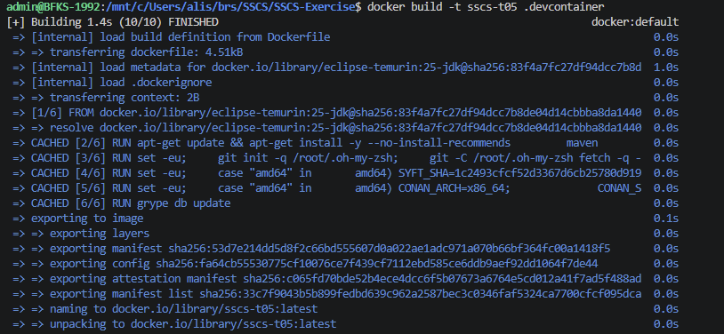
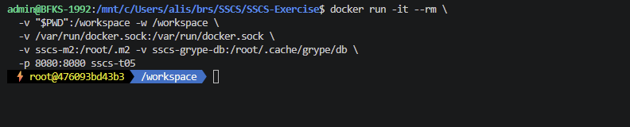
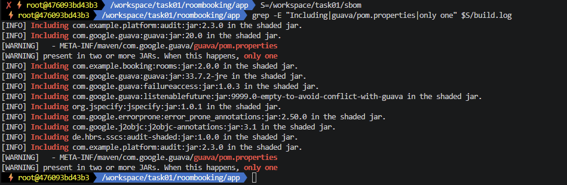
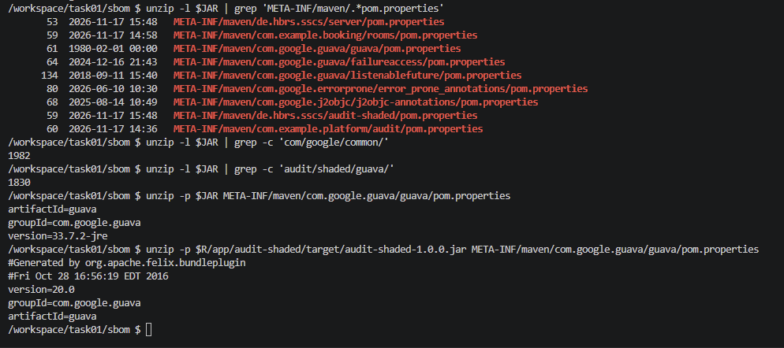
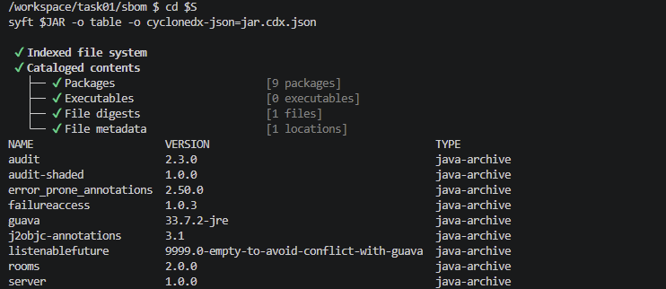
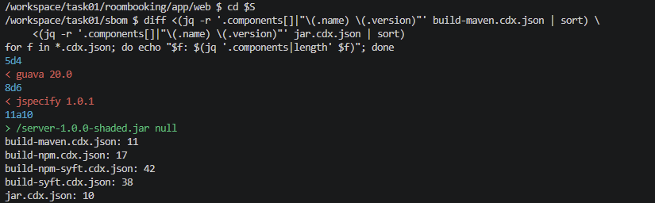
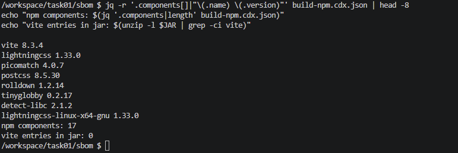

# Task 01 | Know What You Ship

Slide source: one `##` heading = one slide. Screenshots are in `screenshots/`.
"Say" = speaker notes (not on the slide).

---

## Setup: reproducible environment

- Course dev container, base image pinned by digest (`eclipse-temurin:25-jdk@sha256:83f4…`)
- syft 1.56.0 · grype 0.121.1 · grype DB v6.1.10 (built 2026-11-16) · Maven 3.9.12 · x86_64
- Maven cache and grype DB in named volumes → same inputs on every run

**Say:** Every result in this talk was produced inside this container, so it can be reproduced.

---

## The task

A university buys our room booking service and asks for an SBOM.

- Build SBOM of the whole project vs. SBOM of `server-1.0.0-shaded.jar`
- **Q1:** Which components appear in only one of them, and why?
- **Q2:** Which SBOM goes to the university?

| Folder | Role |
|---|---|
| `libs/audit` | vendor library, needs **Guava 20.0** |
| `libs/rooms` | vendor library, needs **Guava 33.7.2-jre** |
| `app/audit-shaded` | our fix from Tutorial 02: audit + private, **relocated** Guava 20.0 |
| `app/server` | our service, shaded into one runnable jar |
| `app/web` | frontend, built with vite |

**Say:** Two vendor libraries need two incompatible Guava versions. Maven keeps only one, so in Tutorial 02 we shaded
Guava 20.0 into audit-shaded and renamed its packages. That fix is the source of today's problem.

---

## Q1 · Step 1: What really ships? (shade log = ground truth)

- **audit-shaded** run: includes audit 2.3.0 and **guava 20.0**
- **server** run: 9 libraries, guava 20.0 is **not** listed: it is hidden *inside* audit-shaded
- Warning: `guava/pom.properties` is present in two or more jars → **only one** is copied

**Say:** The build tool knows exactly what it packed. The warning is the moment Guava 20.0 loses its identity.

---

## Q1 · Step 2: Two Guavas in the jar, one ID card

| | Classes in the jar | `pom.properties` ("ID card") |
|---|---|---|
| Guava 33.7.2-jre (`com/google/common/`) | 1982 | ✅ `version=33.7.2-jre` |
| Guava 20.0 (`…/audit/shaded/guava/`) | 1830 | ❌ overwritten (still `20.0` in audit-shaded) |
| jspecify 1.0.1 | shipped | ❌ never had one |

**Say:** syft identifies Java libraries by reading these ID cards. 9 cards → syft will report 9 components.
The code of Guava 20.0 is shipped, but nothing in the jar says so.

---

## Q1 · Step 3: The jar SBOM (analyzed)

- `syft server-1.0.0-shaded.jar` → **9 packages**
- Only Guava: **33.7.2-jre**
- No guava 20.0, no jspecify

**Say:** Exactly the prediction from the ID cards. syft is not wrong about the metadata; the metadata is wrong
about the content.

---

## Q1 · Step 4: Build SBOM vs. jar SBOM

| Only in | Component | Why |
|---|---|---|
| build SBOM (`<`) | **guava 20.0** | relocated by shading, `pom.properties` overwritten |
| build SBOM (`<`) | **jspecify 1.0.1** | jar ships no `pom.properties` |
| jar SBOM (`>`) | `/server-1.0.0-shaded.jar` | not a library: syft's file entry for the jar itself (SHA-256) |

- Build SBOM (Maven `cyclonedx-maven-plugin`): **11** components = 9 visible + 2 hidden
- All 9 shared components are identical → the SBOMs agree wherever syft can see

**Say:** Missing components are the dangerous error: the vulnerable Guava 20.0 disappears, and a scan of the jar
SBOM gives a false all-clear.

---

## Q1 · Step 5: Extra components (build tools that don't ship)

- npm SBOM of `app/web`: **17** components (vite 8.3.4 and its tree)
- All are `devDependencies`: build tools for the frontend
- vite entries in the jar: **0**

**Say:** The opposite error. Extra components produce false positives: CVEs that don't affect the product but cost
triage time. An SBOM should describe what ships, not what was used to build it.

---

## Q1 · Answer

| SBOM | Components | Error | Consequence |
|---|---|---|---|
| Jar SBOM (syft, analyzed) | 9 | **misses** guava 20.0 + jspecify | false negatives: CVEs overlooked |
| syft `dir:` (source) | 8 / 26 | no resolution, depends on leftovers in `target/` | unreliable |
| npm SBOM | 17 | **extra**: build tools, not shipped | false positives |
| **Maven build SBOM** | **11** | none | matches what ships |

**Why they differ:** shading relocates Guava 20.0 and overwrites its metadata; analysis tools can only see metadata.
The build tool resolved and packed every dependency, so it knows the truth.

---

## Q2 · Which SBOM goes to the university?

<!-- TODO: screenshot T1-6 (grype jar SBOM vs. build SBOM) -->

- **The Maven build SBOM** (11 components), generated during the release build
- Cross-check it against the analyzed SBOM of the jar: every difference must be explained (here: shading)

---

## Reflect · NTIA minimum elements

<!-- TODO: screenshot T1-7 + fill table from its output -->

---

## Reflect · Regenerate for the next release

<!-- TODO: screenshot T1-8 (plugin version not pinned) -->

- Regenerate the **build SBOM** in the release build, from the project's `pom.xml` (resolved dependency graph)
- Pin the SBOM plugin version in `pom.xml`, attach the jar's SHA-256, cross-check with `syft` on the jar
