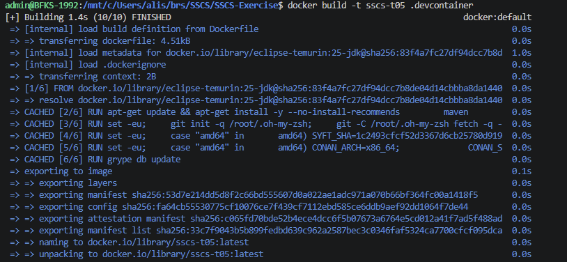
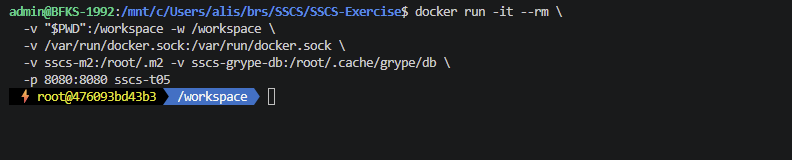
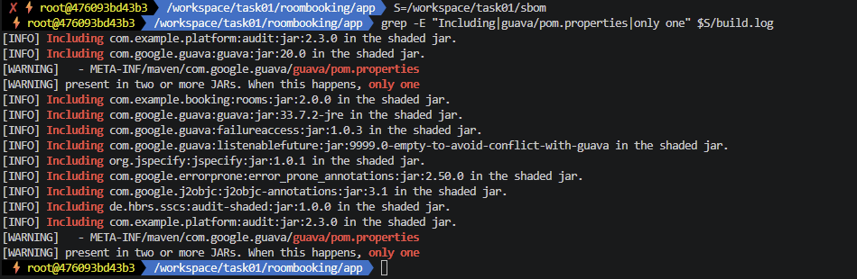
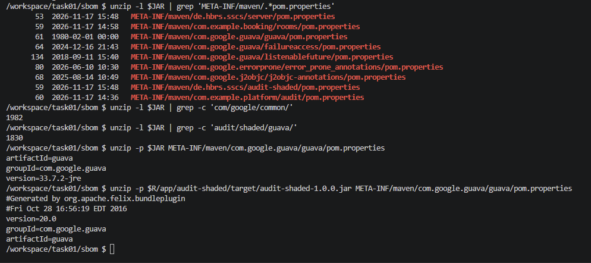
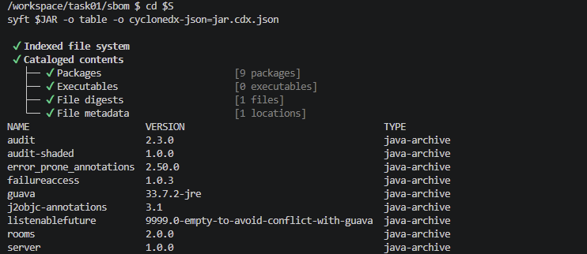
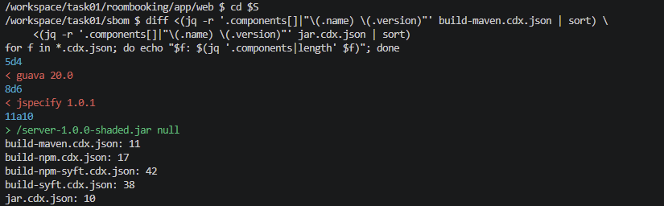
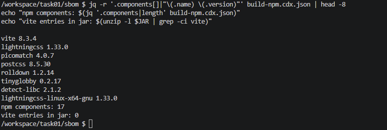
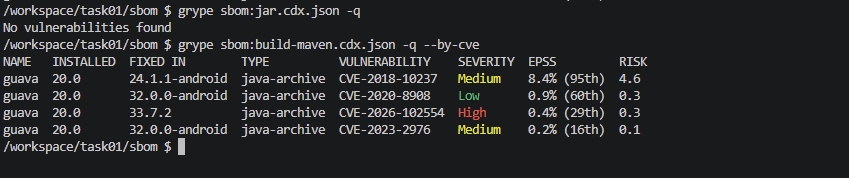
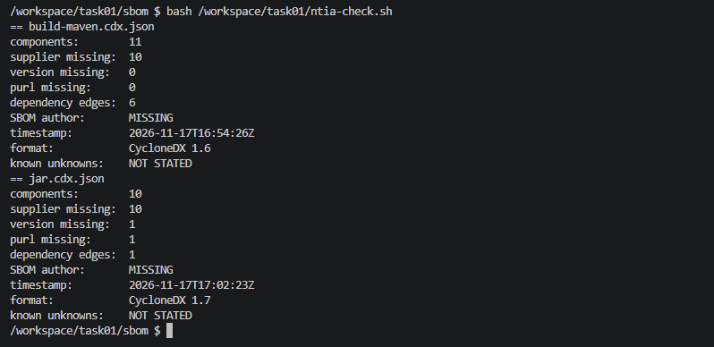

# Task 01 | Know What You Ship

Slide source: one `##` heading = one slide. Screenshots are in `screenshots/`.
"Say" = speaker notes (not on the slide).

---

## Setup: reproducible environment




- Course dev container, base image pinned by digest (`eclipse-temurin:25-jdk@sha256:83f4…`)
- syft 1.56.0 · grype 0.121.1 · grype DB v6.1.10 (built 2026-11-16) · Maven 3.9.12 · x86_64
- Maven cache and grype DB in named volumes → same inputs on every run

**Say:** Every result in this talk was produced inside this container, so it can be reproduced.

---

## The task

A university buys our room booking service and asks for an SBOM.

- Build SBOM of the whole project vs. SBOM of `server-1.0.0-shaded.jar`
- **Q1:** Which components appear in only one of them, and why?
- **Q2:** Which SBOM goes to the university?

| Folder | Role |
|---|---|
| `libs/audit` | vendor library, needs **Guava 20.0** |
| `libs/rooms` | vendor library, needs **Guava 33.7.2-jre** |
| `app/audit-shaded` | our fix from Tutorial 02: audit + private, **relocated** Guava 20.0 |
| `app/server` | our service, shaded into one runnable jar |
| `app/web` | frontend, built with vite |

**Say:** Two vendor libraries need two incompatible Guava versions. Maven keeps only one, so in Tutorial 02 we shaded
Guava 20.0 into audit-shaded and renamed its packages. That fix is the source of today's problem.

---

## Q1 · Step 1: What really ships? (shade log = ground truth)



- **audit-shaded** run: includes audit 2.3.0 and **guava 20.0**
- **server** run: 9 libraries, guava 20.0 is **not** listed: it is hidden *inside* audit-shaded
- Warning: `guava/pom.properties` is present in two or more jars → **only one** is copied

**Say:** The build tool knows exactly what it packed. The warning is the moment Guava 20.0 loses its identity.

---

## Q1 · Step 2: Two Guavas in the jar, one ID card



| | Classes in the jar | `pom.properties` ("ID card") |
|---|---|---|
| Guava 33.7.2-jre (`com/google/common/`) | 1982 | ✅ `version=33.7.2-jre` |
| Guava 20.0 (`…/audit/shaded/guava/`) | 1830 | ❌ overwritten (still `20.0` in audit-shaded) |
| jspecify 1.0.1 | shipped | ❌ never had one |

**Say:** syft identifies Java libraries by reading these ID cards. 9 cards → syft will report 9 components.
The code of Guava 20.0 is shipped, but nothing in the jar says so.

---

## Q1 · Step 3: The jar SBOM (analyzed)



- `syft server-1.0.0-shaded.jar` → **9 packages**
- Only Guava: **33.7.2-jre**
- No guava 20.0, no jspecify

**Say:** Exactly the prediction from the ID cards. syft is not wrong about the metadata; the metadata is wrong
about the content.

---

## Q1 · Step 4: Build SBOM vs. jar SBOM



| Only in | Component | Why |
|---|---|---|
| build SBOM (`<`) | **guava 20.0** | relocated by shading, `pom.properties` overwritten |
| build SBOM (`<`) | **jspecify 1.0.1** | jar ships no `pom.properties` |
| jar SBOM (`>`) | `/server-1.0.0-shaded.jar` | not a library: syft's file entry for the jar itself (SHA-256) |

- Build SBOM (Maven `cyclonedx-maven-plugin`): **11** components = 9 visible + 2 hidden
- All 9 shared components are identical → the SBOMs agree wherever syft can see

**Say:** Missing components are the dangerous error: the vulnerable Guava 20.0 disappears, and a scan of the jar
SBOM gives a false all-clear.

---

## Q1 · Step 5: Extra components (build tools that don't ship)



- npm SBOM of `app/web`: **17** components (vite 8.3.4 and its tree)
- All are `devDependencies`: build tools for the frontend
- vite entries in the jar: **0**

**Say:** The opposite error. Extra components produce false positives: CVEs that don't affect the product but cost
triage time. An SBOM should describe what ships, not what was used to build it.

---

## Q1 · Answer

| SBOM | Components | Error | Consequence |
|---|---|---|---|
| Jar SBOM (syft, analyzed) | 9 | **misses** guava 20.0 + jspecify | false negatives: CVEs overlooked |
| syft `dir:` (source) | 8 / 26 | no resolution, depends on leftovers in `target/` | unreliable |
| npm SBOM | 17 | **extra**: build tools, not shipped | false positives |
| **Maven build SBOM** | **11** | none | matches what ships |

**Why they differ:** shading relocates Guava 20.0 and overwrites its metadata; analysis tools can only see metadata.
The build tool resolved and packed every dependency, so it knows the truth.

---

## Q2 · Which SBOM goes to the university?



| University scans… | Result |
|---|---|
| jar SBOM | **No vulnerabilities found**: false all-clear |
| build SBOM | **4 CVEs** in guava 20.0 (CVE-2018-10237, CVE-2020-8908, CVE-2023-2976, **CVE-2026-102554 High**) |

- Deliver **the Maven build SBOM** (11 components), generated during the release build
- Cross-check it against the analyzed SBOM of the jar: every difference must be explained (here: shading)
- Whether these 4 CVEs actually affect us is the next question (Task 02 → VEX)

**Say:** Same product, 0 findings vs. 4 findings. Only the build SBOM lets the customer see the real risk. Note
FIXED IN 33.7.2 for the High CVE: the version rooms already uses. Only the hidden copy is vulnerable.

---

## Reflect · NTIA minimum elements: what is required

NTIA, *The Minimum Elements for a Software Bill of Materials* (2021): three groups, all required.

| Group | Elements |
|---|---|
| **1. Data fields** | supplier name · component name · version · other unique identifiers · dependency relationship · author of SBOM data · timestamp |
| **2. Automation support** | machine-readable standard format: SPDX, CycloneDX or SWID |
| **3. Practices & processes** | frequency · depth · known unknowns · distribution & delivery · access control · accommodation of mistakes |

**Say:** Only groups 1 and 2 live inside the SBOM file. Most of group 3 is about how we produce and hand over SBOMs,
so it can't be checked with a tool.

---

## Reflect · NTIA: what we checked, and the result



Checked with `ntia-check.sh` (jq on the CycloneDX JSON). ✅ present · ❌ missing · ⚠️ partly

| Element | How checked | build-maven | jar |
|---|---|---|---|
| Supplier name | `components[].supplier` / `publisher` | ❌ 10 of 11 missing | ❌ 9 of 9 missing |
| Component name | `components[].name` | ✅ | ✅ |
| Version | `components[].version` | ✅ | ✅ (1 "missing" = jar file entry) |
| Unique identifiers | `components[].purl` | ✅ PURL | ✅ PURL (1 "missing" = jar file entry) |
| Dependency relationship | `dependencies[].dependsOn` | ✅ 6 nodes with edges | ❌ 1: flat list, no tree |
| Author of SBOM data | `metadata.authors` / `manufacturer` / `supplier` | ❌ only the tool | ❌ only the tool |
| Timestamp | `metadata.timestamp` | ✅ | ✅ |
| Automation support | `bomFormat`, `specVersion` | ✅ CycloneDX 1.6 | ✅ CycloneDX 1.7 |
| Known unknowns | `compositions[].aggregate` | ❌ not stated | ❌ not stated |
| Depth | compared with ground truth (shade log): 11 shipped | ✅ 11/11 | ❌ 9/11 |

**Missing in both:** supplier · SBOM author · known unknowns. **Jar SBOM additionally:** dependency relationship, depth.

**Say:** The jar SBOM's 10th component is syft's entry for the jar file itself, so its one missing version/PURL is
not a real gap. A field can be present and still wrong: the jar SBOM has a version for every library it lists, but it
lists only 9 of 11. Completeness (depth) is the gap a field check can't see; we found it with the Q1 diff. Note also
the two different CycloneDX versions (1.6 vs 1.7): consumers must support both.

---

## Reflect · NTIA: what we did not check, and why

| Element | Why not checked by tool | How we address it |
|---|---|---|
| **Frequency** | a process: "new SBOM for every release", not a field | regenerate the build SBOM in every release build (next slide) |
| **Distribution & delivery** | how the university receives it; not in the file | ship the SBOM next to the jar, referenced by the jar's SHA-256 |
| **Access control** | who may read it; a contract/hosting question | agree with the customer (e.g. customer portal) |
| **Accommodation of mistakes** | a process: tolerate and correct errors | the jar SBOM's missing Guava 20.0 is such a mistake → corrected version = build SBOM |
| Correctness of each value | a tool only sees *presence*, not *truth* | cross-check against the build (shade log, Q1 diff) |

**Say:** These are organisational duties. No SBOM tool can tick them off for us.

---

## Reflect · Which SBOM do we regenerate, from which input?

> The **Maven build SBOM**, regenerated **in every release build** (same `mvn` run that produces the jar), from
> `pom.xml` + Maven's **resolved dependency graph**.
> **Cross-check:** analyzed SBOM of the delivered jar (syft). Every difference must be explained.

| Input | Result in our run | Problem |
|---|---|---|
| finished jar (syft) | 9 of 11 | blind to shaded/relocated code → **cross-check only** |
| source folder (syft `dir:`) | 8 or 26 | no resolution; depends on leftovers in `target/` |
| `package-lock.json` (npm) | 17 | build tools, not shipped |
| **Maven resolved graph** | **11 of 11** | ✅ the build knows what it packs |

**Say:** syft reads files, Maven *is* the build. Only the build knows about managed versions, transitive dependencies
and what the shade step packs.

---

## Reflect · Make regeneration reproducible: pin the SBOM tool

```bash
jq -r '.metadata.tools.components[]? | "\(.name) \(.version)"' build-maven.cdx.json
jq -r '.metadata.timestamp' build-maven.cdx.json
grep -c cyclonedx $R/app/pom.xml
```
```
cyclonedx-maven-plugin 2.9.3
2026-11-17T16:54:26Z
0
```

| Check | Result | Meaning |
|---|---|---|
| plugin version used | `cyclonedx-maven-plugin 2.9.3` | chosen by Maven, not by us |
| timestamp | `2026-11-17T16:54:26Z` | made by hand, after the build |
| `grep -c cyclonedx app/pom.xml` | `0` | not declared → not pinned, not part of the build |

**Risk:** the next release may use another plugin version, so the same code gives a different SBOM, and someone may
forget to run it at all. Already visible today: build SBOM CycloneDX 1.6 vs. jar SBOM 1.7.

**Fix** in `app/pom.xml`:
```xml
<plugin>
  <groupId>org.cyclonedx</groupId>
  <artifactId>cyclonedx-maven-plugin</artifactId>
  <version>2.9.3</version>                     <!-- pinned -->
  <executions>
    <execution>
      <phase>package</phase>                   <!-- runs in every build -->
      <goals><goal>makeAggregateBom</goal></goals>
    </execution>
  </executions>
</plugin>
```

**Also for the next release:**
- Pin syft (1.56.0) for the cross-check
- Record the jar's SHA-256 in the SBOM, so it names exactly the delivered file
- Close the NTIA gaps: set the author (`<organization>`) and declare known unknowns

**Say:** An SBOM process is only trustworthy if the same input always gives the same SBOM, and if it runs
automatically.
